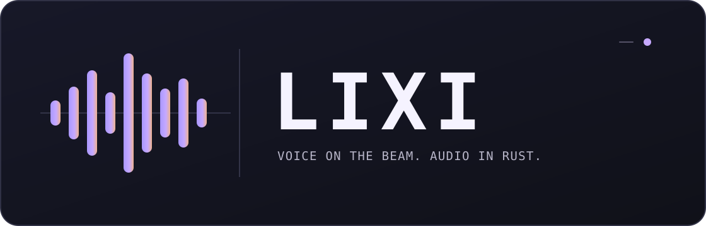

# Lixi

<p align="center">
  
</p>


**Lixi** is a Lavalink v4-compatible audio server built with Elixir/OTP,
[EDA](https://github.com/qoyri/EDA), and Rust. Elixir owns Discord Voice,
encryption, UDP transmission, and the playback clock. A separate Rust process
decodes media, applies filters, and produces Opus frames.

The client bot owns the main Discord Gateway. Lixi receives its Voice connection
information through the Lavalink API and does not require a bot token.

## Features

- Lavalink v4 REST, WebSocket events, track encoding, and session resume.
- WAV PCM and MP3 playback from allowed local files or finite HTTP resources.
- Volume, equalizer, karaoke, timescale, tremolo, vibrato, rotation, distortion,
  channelMix, and lowPass filters.
- Isolated Rust audio workers with bounded input reads and output credits.
- BEAM plugin packages with source/HTTP callbacks and version leases.
- Compatible live BEAM patches, rollback, drain, and readiness checks.
- Raft ownership metadata with additional worker instances.

## Quick start

Requires Elixir 1.20, OTP 29, Rust 1.88+, a C/C++ compiler, CMake, and libclang.
Build native components for the deployment OS and architecture.

```sh
mix deps.get
mix lixi.native

export LIXI_PASSWORD='change-this-password'
export LIXI_ADMIN_TOKEN='a-separate-admin-token-at-least-16-bytes'
export LIXI_SOURCE_ROOTS='/absolute/path/to/music'
mix run --no-halt
```

The default address is `127.0.0.1:2333`.

```sh
curl http://127.0.0.1:2333/version
curl -H "Authorization: $LIXI_PASSWORD" http://127.0.0.1:2333/v4/info
```

Configure the bot's Lavalink client with the same host, port, and password.
WebSocket connections require `Authorization`, `User-Id`, and `Client-Name`.
See [getting started](docs/getting-started.md) for media setup and client
integration.

## Architecture

```text
client bot ── REST / WebSocket ──▶ session controller
                                          │
                                          ▼
                                  guild Player
                                  │          │
                            source bytes     │ raw Opus
                                  ▼          ▼
                           Rust audio ──▶ EDA Voice ── UDP ──▶ Discord

Raft coordinates ownership. Voice keys and audio stay on the media node.
```

Audio queues hold raw Opus. The Voice sender applies DAVE and transport
encryption at send time. A failed audio worker can restart while the existing
Voice connection remains alive.

See [architecture](docs/architecture.md) for process ownership and failure
boundaries.

## API

| Route | Purpose |
| --- | --- |
| `/version`, `/v4/info`, `/v4/stats` | Version, capabilities, and local statistics |
| `/v4/loadtracks`, `/v4/decodetrack`, `/v4/decodetracks` | Resolve and decode tracks |
| `/v4/websocket` | Sessions, playback events, updates, and resume |
| `/v4/sessions/{sessionId}` | Resume policy and timeout |
| `/v4/sessions/{sessionId}/players/{guildId}` | Player control |
| `/v4/plugins/{name}/...` | Plugin HTTP callbacks |
| `/v4/lixi/*` | Admin management API |
| `/health/live`, `/health/ready` | Liveness and readiness |

Use the password directly in `Authorization`, without `Bearer`.
`/version` and health endpoints are public. Management routes also require
`x-lixi-admin-token`. See the [API reference](docs/api.md).

## Plugins

```sh
mix lixi.plugin.new radio --module RadioPlugin.V1 --output plugins/radio
mix lixi.plugin.pack plugins/radio --output data/plugins/staging/radio-1.0.0

mix lixi.admin POST /plugins/packages \
  --body '{"bundle":"radio-1.0.0","config":{"tracks":{}}}'
mix lixi.admin POST /plugins/radio/activate --body '{"version":"1.0.0"}'
```

Plugins are trusted BEAM code. New versions use separate module namespaces;
in-flight callbacks retain their original version. Installed packages and
configuration are restored at startup.

See the [plugin guide](docs/plugins.md) and
[radio example](examples/plugins/radio/lib/plugin.ex).

## Operations

```sh
mix lixi.admin GET /instances
mix lixi.admin POST /drain
mix lixi.admin GET /status
mix lixi.admin POST /resume
```

Drain blocks new admission while preserving existing control and playback.
Compatible BEAM patches preserve media processes. OTP, NIF, Voice/crypto, and
native protocol changes require drain and release replacement.

Cluster deployments use fixed Raft voters and additional workers. Existing
Voice resources are not automatically moved between nodes.
See [operations](docs/operations.md) and the
[Kubernetes example](deploy/kubernetes.yaml).

## Development

```sh
mix check
cargo fmt --manifest-path native/audio_engine/Cargo.toml --check
cargo clippy --manifest-path native/audio_engine/Cargo.toml --all-targets -- -D warnings
cargo test --manifest-path native/audio_engine/Cargo.toml
MIX_ENV=prod mix release
```

`mix check` runs formatting, compilation, and application tests. Native checks
require the build toolchain above.

## Limits

- Built-in sources support finite WAV PCM and MP3 resources. HTTP sources
  require a strong ETag and correct byte-range responses.
- YouTube/SoundCloud search, Java JAR plugins, and an active RoutePlanner are
  not included. `frameStats` is currently `null`.
- Raft does not replicate audio, Voice secrets, DAVE resources, or durable copies
  of every session. Network uncertainty does not trigger a second Voice sender.
- macOS arm64 is locally verified. Live Discord channel transmission,
  cross-host TLS, production load, and the supplied Linux/Kubernetes deployment
  examples remain unverified.

## Documentation

[Getting started](docs/getting-started.md) ·
[Configuration](docs/configuration.md) ·
[API](docs/api.md) ·
[Architecture](docs/architecture.md) ·
[Plugins](docs/plugins.md) ·
[Operations](docs/operations.md)
